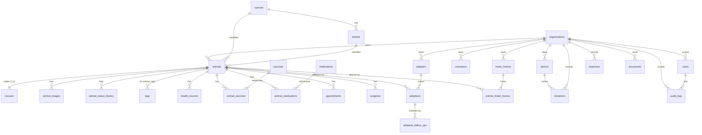

# Entity-Relationship Diagram

Rendered from the relationships in the migrations. `schema.dbml` is the source
for a richer render on [dbdocs.io](https://dbdocs.io). Lookup tables are grouped
at the bottom to keep the diagram legible.

## Lookups (configurable per organization; `NULL` org = system default)

`animal_statuses`, `animal_sizes`, `adoption_statuses`,
`adoption_follow_up_statuses`, `donation_types`, `expense_categories`, `tags`.

## Global reference (shared, not org-scoped)

`species`, `breeds`, `vaccines`, `medications`.
